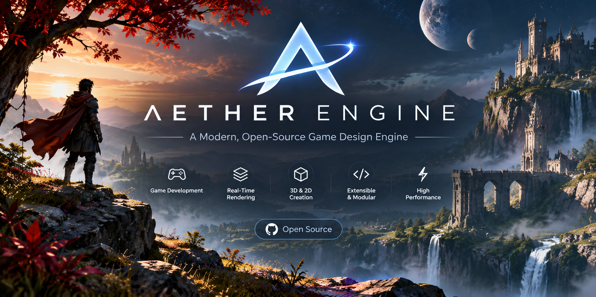
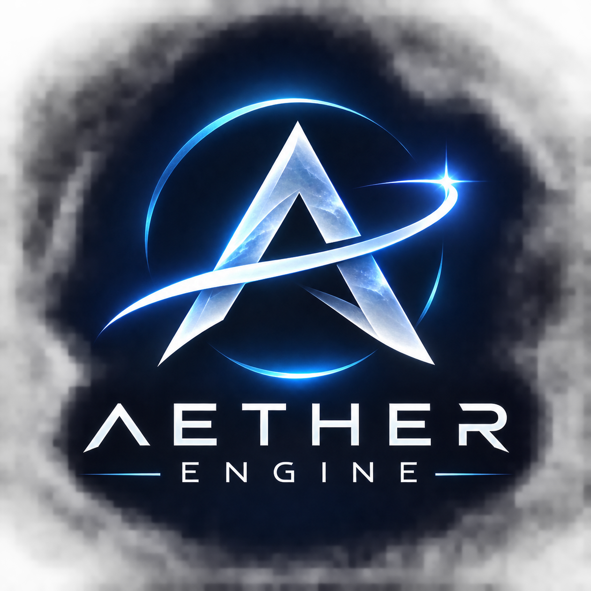

<div align="center">

  

  <br />

  

  <h1>AETHER ENGINE</h1>

  **Render worlds. Simulate systems. Build what comes next.**

  An independent, open-source 3D game engine and world-simulation platform.

  <p>
    <a href="https://github.com/fried-brain/aether-engine/actions"></a>
    <a href="LICENSE"></a>
    
    
    
  </p>

  <p>
    <a href="#vision">Vision</a> ·
    <a href="#capabilities">Capabilities</a> ·
    <a href="#architecture">Architecture</a> ·
    <a href="#build-from-source">Build</a> ·
    <a href="#development-status">Development status</a> ·
    <a href="CONTRIBUTING.md">Contributing</a>
  </p>

</div>

---

> **Project status:** AETHER ENGINE is under active early-stage development. The native platform foundation and the first core/runtime logging slice have been merged. The renderer, editor, physics, world simulation and other advanced systems remain planned or under development; they are not represented as completed features.

## Vision

AETHER ENGINE is an independent technology platform for building interactive 2D and 3D worlds.

The long-term goal is to bring real-time graphics, physics, procedural environments, animation, audio, AI and scientific simulation together behind a coherent, modular architecture. Systems should have clear boundaries, remain replaceable where practical, and earn their place through working code, tests and documented behaviour.

This is a long-term engineering effort. The priority is a dependable engine foundation—not a feature list that exists only on paper.

## Capabilities

The following describes the intended direction of the engine. A capability becomes implemented only when its code and acceptance evidence support that claim.

| Domain | Direction |
|---|---|
| **Real-time graphics** | Vulkan-first rendering, physically based materials, lighting and shadows |
| **World creation** | Scene management, terrain, procedural generation, streaming and weather |
| **Physics & simulation** | Rigid-body dynamics, collision, fluids, thermal behaviour and extensible solvers |
| **Creation tools** | Native desktop editor, asset pipeline and reusable project templates |
| **Gameplay** | Entity-component architecture, animation and Lua scripting |
| **AI** | NPC behaviour and optional language-model integrations |
| **Multiplayer** | Server-authoritative networking and synchronized simulation |
| **Audio** | Spatial audio and extensible sound systems |

## Architecture

AETHER is designed as a modular native engine. Engine-facing interfaces should remain independent of third-party implementation details wherever practical.

| Layer | Responsibility |
|---|---|
| **Core** | Application lifecycle, modules, events, time and diagnostics |
| **Platform** | Native windows, input and operating-system integration |
| **Runtime** | Memory, jobs, entities, components and scenes |
| **Graphics** | Rendering abstraction, Vulkan backend, resources and materials |
| **Simulation** | Physics, material models and scientific solvers |
| **World** | Terrain, procedural content, streaming and environment |
| **Tools** | Native editor, asset pipeline and developer utilities |
| **Services** | Optional scripting, AI and networking integrations |

### Technology baseline

| Area | Current direction |
|---|---|
| Language | C++20 |
| Build system | CMake 3.25+ |
| Initial desktop targets | Windows and Linux |
| Platform layer | SDL3 3.4.20 behind AETHER-owned interfaces |
| Graphics API | Vulkan — planned, not yet integrated |
| Editor | Native desktop application — planned |
| License | Apache License 2.0 |

Third-party dependencies retain their own licenses and notices. A library being listed as a candidate or planned technology does not mean it has been integrated. See [THIRD_PARTY_NOTICES.md](THIRD_PARTY_NOTICES.md).

## Build from source

### Requirements

- CMake 3.25 or newer
- A C++ compiler with C++20 support
- Git
- Internet access for the initial SDL3 source download

### Linux prerequisites (Ubuntu/Debian)

SDL3 is built from source by CMake. Install the X11 development packages used by the CI workflow before configuring:

```bash
sudo apt-get update
sudo apt-get install --yes libx11-dev libxext-dev libxrandr-dev libxcursor-dev libxfixes-dev libxi-dev libxss-dev libxinerama-dev libxkbcommon-dev libxtst-dev
```

Other Linux distributions need equivalent development packages for their supported window-system configuration. The headless test driver does not remove SDL's configure-time development-library requirements.

### Clone

```bash
git clone https://github.com/fried-brain/aether-engine.git
cd aether-engine
```

### Configure and build

Debug:

```bash
cmake --preset debug
cmake --build --preset debug
```

Release:

```bash
cmake --preset release
cmake --build --preset release
```

### Run tests

```bash
ctest --test-dir build/debug -C Debug --output-on-failure
```

The current foundation builds the SDL-backed platform library and its contract-test executable, alongside the initial core/status/logging library and tests. It does **not** yet produce a complete runnable game engine, renderer or editor.

## Development status

AETHER ENGINE is developed in reviewable milestones. Merged code is distinguished from work that is still planned.

| Milestone | Scope | Status |
|---|---|---|
| **M1.1** | Build and native platform foundation | <strong>Merged</strong> |
| **M1.2** | Core status, logging and runtime foundations | <strong>In progress</strong> |
| **M1.3** | Memory and job infrastructure | Planned |
| **M1.4** | ECS, scenes and CI expansion | Planned |
| **M2** | Rendering foundation and graphics resources | Planned |
| **M3** | Physics and simulation foundations | Planned |
| **M4** | World systems, asset pipeline and editor foundations | Planned |

### Merged foundation

**M1.1 — Native platform foundation**
- SDL3 pinned to version 3.4.20
- AETHER-owned platform, window and input-event interfaces
- RAII window ownership and platform-state lifetime management
- Windows and Linux CI builds
- Headless platform contract tests

**M1.2 — Initial core/runtime slice**
- Core `Status` and `ErrorCode` foundation
- Engine-owned logging interface and console sink
- UTC ISO-8601 millisecond timestamps
- Log-level filtering and serialized per-logger sink writes
- Thread dependency propagated through the core target
- Initial logging and status contract tests

### M1.2 still in progress

The merged logging slice is not the complete M1.2 milestone. Remaining work includes:

- Deterministic module registration and dependency ordering
- Application lifecycle state machine and rollback
- Monotonic clock and frame-time contract
- Typed synchronous event dispatcher
- Integration tests, failure-path tests and documentation

See the [M1.2 engineering specification](documentation/specifications/M1.2-Core-Runtime-and-Logging-v1.0.md) for the approved behavioural contract.

A milestone is complete only after its acceptance criteria have been implemented, verified and accepted.

## Engineering principles

1. **Build independently.** Create original systems and interfaces; do not copy proprietary engine code or protected assets.
2. **Keep boundaries clear.** Subsystems should be modular and replaceable where practical.
3. **Correctness before complexity.** Prefer understandable, testable foundations over premature optimization.
4. **Show the evidence.** Distinguish implemented, experimental and planned work.
5. **Treat dependencies responsibly.** Review versions, licenses, attribution, security and maintenance.
6. **Keep the core offline-capable.** Cloud services and external AI providers remain optional to the native runtime.

## Contributing

Thoughtful contributions are welcome as the project matures.

Before proposing a substantial change, read [CONTRIBUTING.md](CONTRIBUTING.md), review the roadmap and open an issue or discussion so the design can be aligned first. Behavioural changes should include tests and documentation.

Do not submit proprietary code, unlicensed assets, credentials or confidential material.

## License

AETHER ENGINE is licensed under the **Apache License 2.0**. See [LICENSE](LICENSE) for the full terms.

Third-party components retain their own licenses and notices. See [THIRD_PARTY_NOTICES.md](THIRD_PARTY_NOTICES.md).

---

<div align="center">

  

  **AETHER ENGINE**

  *Render · Simulate · Create · Explore*

  <sub>Built in the open. Engineered one verified milestone at a time.</sub>

</div>
