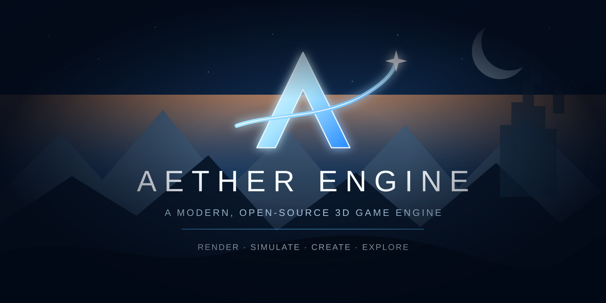

<div align="center">

  

  # AETHER ENGINE

  **A modern, open-source 3D game engine and world simulation platform.**

  <p>
    <a href="https://github.com/fried-brain/aether-engine/actions"></a>
    <a href="LICENSE"></a>
    
    
    
  </p>

  <p>
    <a href="#vision">Vision</a> ·
    <a href="#capabilities">Capabilities</a> ·
    <a href="#architecture">Architecture</a> ·
    <a href="#build">Build</a> ·
    <a href="#roadmap">Roadmap</a> ·
    <a href="CONTRIBUTING.md">Contributing</a>
  </p>

</div>

<p align="center">
  
</p>

---

> **Project status — early foundation stage.** AETHER ENGINE is under active initial development. The repository currently contains its C++20/CMake foundation and cross-platform CI checks. The renderer, editor, physics integration and other engine systems described below are goals on the roadmap, not finished features.

## The vision

AETHER ENGINE is an independent engine project built around one idea: give creators a modular foundation for building interactive worlds, from compact 2D experiences to ambitious 3D simulations.

The long-term direction brings real-time rendering, extensible physics, procedural environments, animation, audio, AI and scientific simulation under one coherent engine architecture. The goal is not to imitate another engine, but to develop a distinct, open technology platform with clear interfaces and room to evolve.

## Capabilities

The following describes the **planned direction** of the engine.

| Area | Direction |
|---|---|
| **Rendering** | Vulkan-first rendering architecture, physically based materials, lighting and shadows |
| **Worlds** | Scene management, terrain, procedural generation, streaming and environmental systems |
| **Physics** | Rigid-body dynamics, collision and extensible simulation interfaces |
| **Scientific simulation** | Material properties, thermal behaviour, fluids and other domain-specific solvers |
| **Creation tools** | Native desktop editor, asset workflows and reusable project templates |
| **Gameplay** | Entity-component architecture, animation and Lua scripting |
| **AI** | NPC behaviour systems and optional integrations with language models |
| **Networking** | Multiplayer architecture with server-authoritative simulation |
| **Audio** | Spatial audio and extensible sound systems |

These systems will be introduced incrementally and marked as implemented only after their tests and acceptance criteria pass.

## Architecture

AETHER is designed as a modular native engine. Engine-facing interfaces should remain independent of third-party implementation details wherever practical.

| Layer | Responsibility |
|---|---|
| Core | Application lifecycle, modules, events, time and diagnostics |
| Platform | Windows, Linux, windowing, input and system capabilities |
| Runtime | Memory, jobs, entities, components and scenes |
| Graphics | Rendering abstraction, Vulkan backend, resources and materials |
| Simulation | Physics, material models and extensible scientific solvers |
| World | Terrain, procedural content, streaming and environment |
| Tools | Native editor, asset pipeline and developer utilities |
| Services | Optional scripting, AI and networking integrations |

### Initial technology baseline

| Component | Initial direction |
|---|---|
| Language | C++20 |
| Build system | CMake 3.25+ |
| Graphics API | Vulkan (planned; not integrated yet) |
| Desktop targets | Windows and Linux |
| Editor | Native desktop application |
| License | Apache License 2.0 |

Third-party libraries are evaluated separately. A candidate dependency is not considered integrated or approved merely because it appears in the architecture plan. See [THIRD_PARTY_NOTICES.md](THIRD_PARTY_NOTICES.md).

## Build

### Requirements

- CMake 3.25 or newer
- A C++ compiler with the required C++20 language and standard-library support
- Git

### Configure and build

Clone the repository:

```bash
git clone https://github.com/fried-brain/aether-engine.git
cd aether-engine
```

Configure and build the Debug preset:

```bash
cmake --preset debug
cmake --build --preset debug
```

Configure and build the Release preset:

```bash
cmake --preset release
cmake --build --preset release
```

The current CMake target is an **interface-only foundation**. These commands verify the initial project configuration; they do not yet produce a runnable game engine or editor.

## Roadmap

Development is milestone-driven. Each milestone has its own engineering specification, implementation tasks and acceptance evidence.

| Milestone | Scope | Status |
|---|---|---|
| **M1.1** | Build and native platform foundation | In progress |
| **M1.2** | Core runtime and logging | Planned |
| **M1.3** | Memory and job infrastructure | Planned |
| **M1.4** | ECS, scenes and CI expansion | Planned |
| **M2** | Rendering foundation and graphics resources | Planned |
| **M3** | Physics and simulation foundations | Planned |
| **M4** | World systems, asset pipeline and editor foundations | Planned |

The roadmap is directional and may be refined as engineering work exposes new requirements. A milestone is not complete until its defined acceptance criteria have been verified.

## Current verification

The initial GitHub Actions workflow configures and builds the Debug and Release presets on both Linux and Windows.

- Ubuntu runner: passing
- Windows runner: passing
- C++20 compiler capability check: included
- CI workflow: [view runs](https://github.com/fried-brain/aether-engine/actions)

These checks validate the current build foundation. They do not yet validate graphics hardware, rendering output, window creation or runtime behaviour.

## Project principles

1. **Independent engineering.** Build original systems and interfaces; do not copy proprietary engine code or protected assets.
2. **Modularity.** Keep subsystems replaceable and their boundaries explicit.
3. **Correctness before complexity.** Prefer testable foundations over premature optimization.
4. **Evidence over claims.** Document what works, what is experimental and what remains planned.
5. **Responsible dependencies.** Review versions, licenses, security and maintenance before integration.
6. **Offline-capable core.** Cloud services and external AI providers must remain optional to the native runtime.

## Contributing

AETHER ENGINE is open source, and thoughtful contributions are welcome as the project matures.

Before proposing a substantial change, read [CONTRIBUTING.md](CONTRIBUTING.md), check the current roadmap and open an issue or discussion to align on the design. Include tests and documentation for behavioural changes.

Please do not submit proprietary code, unlicensed assets, credentials or confidential material.

## License

AETHER ENGINE is licensed under the **Apache License 2.0**. You may use, modify and distribute the project under the terms of that license. See [LICENSE](LICENSE).

Third-party components retain their own licenses and notices; see [THIRD_PARTY_NOTICES.md](THIRD_PARTY_NOTICES.md).

---

<div align="center">

  

  **AETHER ENGINE**

  *Render · Simulate · Create · Explore*

  <sub>Built in the open. Engineered one verified milestone at a time.</sub>

</div>
