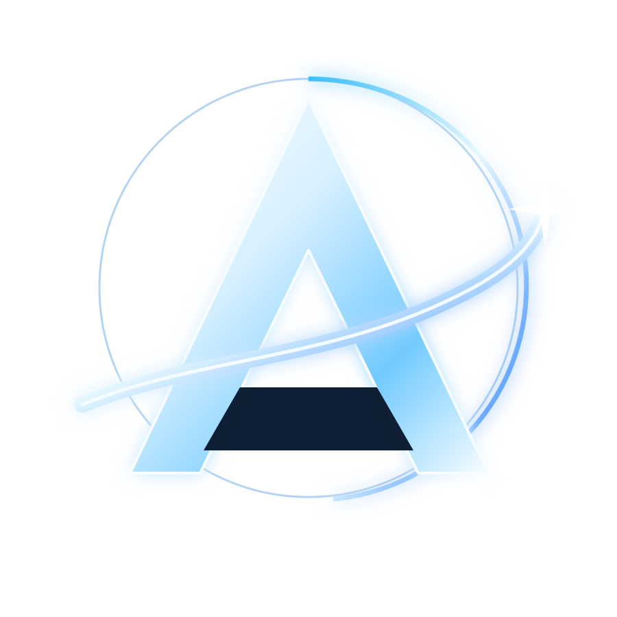

<div align="center">

  

  # AETHER ENGINE

  **Render worlds. Simulate systems. Build what comes next.**

  An independent, open-source 3D game engine and world-simulation platform.

  <p>
    <a href="https://github.com/fried-brain/aether-engine/actions"></a>
    <a href="LICENSE"></a>
    
    
    
  </p>

  <p>
    <a href="#the-idea">The idea</a> ·
    <a href="#planned-capabilities">Capabilities</a> ·
    <a href="#architecture">Architecture</a> ·
    <a href="#get-started">Get started</a> ·
    <a href="#roadmap">Roadmap</a> ·
    <a href="CONTRIBUTING.md">Contributing</a>
  </p>

</div>

<p align="center">
  
</p>

---

> **Development status:** AETHER ENGINE is in its early foundation stage. M1.1 introduces the native platform layer. The renderer, editor, physics, world simulation and other systems below describe the project's direction; they are not presented as completed features.

## The idea

AETHER ENGINE is being built as an independent technology platform for interactive 2D and 3D worlds.

The ambition is to bring graphics, physics, procedural environments, animation, audio, AI and scientific simulation together behind a coherent, modular architecture. Each system should have a clear boundary, be replaceable where practical, and earn its place through working code and tests.

This is a long-term engineering project. The priority is a dependable foundation—not a long list of features that only exist on paper.

## Planned capabilities

| Domain | Direction |
|---|---|
| **Real-time graphics** | Vulkan-first rendering, physically based materials, lighting and shadows |
| **World creation** | Scene management, terrain, procedural generation, streaming and weather |
| **Physics & simulation** | Rigid-body dynamics, collision, fluids, thermal behaviour and extensible solvers |
| **Creation tools** | Native desktop editor, asset pipeline and reusable project templates |
| **Gameplay** | Entity-component architecture, animation and Lua scripting |
| **AI** | NPC behaviour and optional language-model integrations |
| **Multiplayer** | Server-authoritative networking and synchronized simulation |
| **Audio** | Spatial audio and extensible sound systems |

Capabilities will move from planned to implemented only when their acceptance criteria and tests support that claim.

## Architecture

AETHER is a modular native engine. Public engine interfaces are intended to remain independent of third-party implementation details wherever practical.

| Layer | Responsibility |
|---|---|
| **Core** | Application lifecycle, modules, events, time and diagnostics |
| **Platform** | Native windows, input and operating-system integration |
| **Runtime** | Memory, jobs, entities, components and scenes |
| **Graphics** | Rendering abstraction, Vulkan backend, resources and materials |
| **Simulation** | Physics, material models and scientific solvers |
| **World** | Terrain, procedural content, streaming and environment |
| **Tools** | Native editor, asset pipeline and developer utilities |
| **Services** | Optional scripting, AI and networking integrations |

### Technology baseline

| Area | Current direction |
|---|---|
| Language | C++20 |
| Build | CMake 3.25+ |
| Desktop targets | Windows and Linux |
| Platform layer | SDL3 3.4.20, behind AETHER-owned interfaces |
| Graphics API | Vulkan — planned, not yet integrated |
| Editor | Native desktop application — planned |
| License | Apache License 2.0 |

Third-party dependencies are tracked separately. A library being mentioned as a candidate does not mean it has been integrated. See [THIRD_PARTY_NOTICES.md](THIRD_PARTY_NOTICES.md).

## Get started

### Requirements

- CMake 3.25 or newer
- A C++ compiler with C++20 support
- Git
- Internet access for the initial SDL3 source download

### Linux build prerequisites (Ubuntu/Debian)

SDL3 is built from source by CMake. On Ubuntu/Debian, install the X11 development packages used by the CI workflow before configuring:

```bash
sudo apt-get update
sudo apt-get install --yes libx11-dev libxext-dev libxrandr-dev libxcursor-dev libxfixes-dev libxi-dev libxss-dev libxinerama-dev libxkbcommon-dev libxtst-dev
```

Other Linux distributions need the equivalent development packages for their supported window-system configuration. The headless test driver does not remove SDL's configure-time development-library requirements.

### Clone

```bash
git clone https://github.com/fried-brain/aether-engine.git
cd aether-engine
```

### Configure and build

Debug:

```bash
cmake --preset debug
cmake --build --preset debug
```

Release:

```bash
cmake --preset release
cmake --build --preset release
```

### Run platform tests

```bash
ctest --test-dir build/debug -C Debug --output-on-failure
```

The current milestone builds the SDL-backed platform library and its contract-test executable. It covers native window lifecycle and selected input/event translation behind AETHER interfaces. It does **not** yet produce a complete runnable game engine, renderer or editor.

## Project status

### M1.1 — Native platform foundation

- SDL3 pinned to version 3.4.20
- AETHER-owned platform, window and input-event interfaces
- RAII window ownership and platform-state lifetime management
- Linux and Windows Debug/Release CI builds
- Headless platform contract tests

**Latest CI:** [Run #25 — successful](https://github.com/fried-brain/aether-engine/actions/runs/44750242516). Both Linux and Windows jobs passed. This verifies the current CI build and test workflow; it does not validate native display drivers, GPU surfaces or rendered output.

M1.1 remains under pull-request review. See [PR #1](https://github.com/fried-brain/aether-engine/pull/1).

## Roadmap

| Milestone | Scope | Status |
|---|---|---|
| **M1.1** | Build and native platform foundation | In review |
| **M1.2** | Core runtime and logging | Planned |
| **M1.3** | Memory and job infrastructure | Planned |
| **M1.4** | ECS, scenes and CI expansion | Planned |
| **M2** | Rendering foundation and graphics resources | Planned |
| **M3** | Physics and simulation foundations | Planned |
| **M4** | World systems, asset pipeline and editor foundations | Planned |

A milestone is complete only after its defined acceptance criteria have been verified and accepted.

## Engineering principles

1. **Build independently.** Create original systems and interfaces; do not copy proprietary engine code or protected assets.
2. **Keep boundaries clear.** Subsystems should be modular and replaceable where practical.
3. **Correctness before complexity.** Prefer understandable, testable foundations over premature optimization.
4. **Show the evidence.** Distinguish implemented, experimental and planned work.
5. **Treat dependencies responsibly.** Review versions, licenses, attribution, security and maintenance.
6. **Keep the core offline-capable.** Cloud services and external AI providers remain optional to the native runtime.

## Contributing

Thoughtful contributions are welcome as the project matures.

Before proposing a substantial change, read [CONTRIBUTING.md](CONTRIBUTING.md), review the roadmap and open an issue or discussion so the design can be aligned first. Behavioural changes should include tests and documentation.

Do not submit proprietary code, unlicensed assets, credentials or confidential material.

## License

AETHER ENGINE is licensed under the **Apache License 2.0**. See [LICENSE](LICENSE) for the full terms.

Third-party components retain their own licenses and notices. See [THIRD_PARTY_NOTICES.md](THIRD_PARTY_NOTICES.md).

---

<div align="center">

  

  **AETHER ENGINE**

  *Render · Simulate · Create · Explore*

  <sub>Built in the open. Engineered one verified milestone at a time.</sub>

</div>
